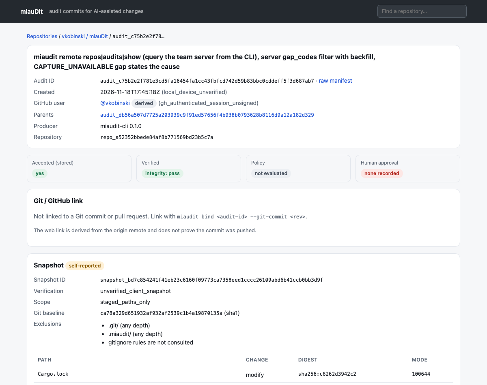
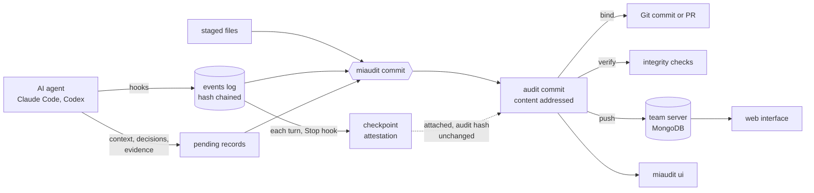
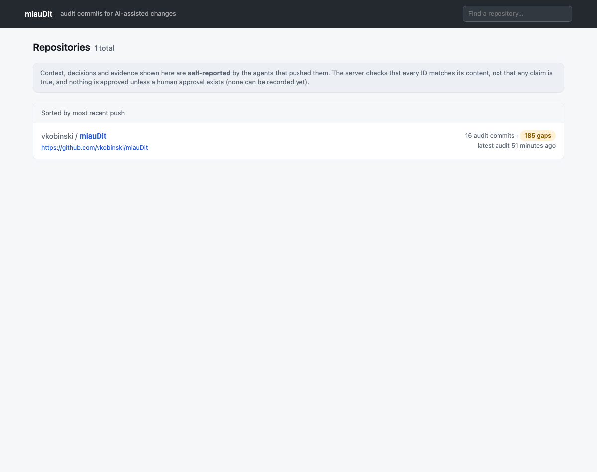
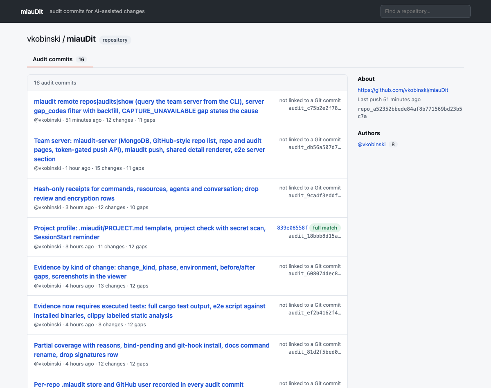
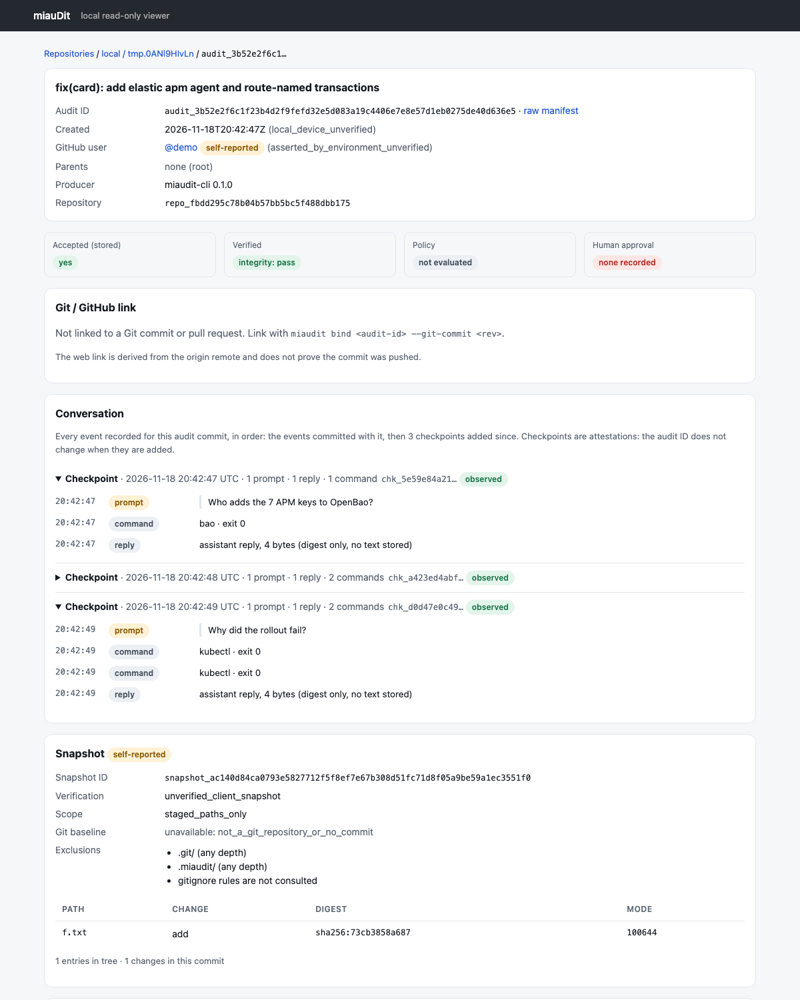

<div align="center">


# miauDit

**A tamper-evident audit trail for AI-assisted code changes.**<br>
What was asked, what the agent did, what evidence backs it, and where the record has holes.


[Quick start](#quick-start) ·
[How it works](#how-it-works) ·
[Commands](#commands) ·
[Team server](#team-server) ·
[What it proves](#what-it-proves-and-what-it-does-not) ·
[Docs](#documentation)

</div>

---

A Git diff shows the result of a change. It does not show the request behind it, the files and tools the agent touched, the alternatives it rejected, or what a human actually decided. miauDit records that next to your code, in a form you can verify later.

> `miau` is how a cat says *meow* in Portuguese. The cat meows; miauDit writes it down.

<p align="center">
  
</p>

## Why

- **Git keeps the what, not the why.** An audit commit keeps the request, the decisions with their alternatives and risks, and the evidence (test output, screenshots, command results) beside the exact files that changed.
- **Honest about gaps.** Anything missing, self-reported or only partly captured is listed as a *gap* on the audit commit instead of being quietly left out.
- **Agents do not grade themselves.** Everything an agent writes is labelled `self_reported`. Only events captured by hooks are `observed`. Nothing is marked approved unless a human approval exists, and none can be recorded yet.
- **It runs where you work.** A local store in `.miaudit/`, a Claude Code hook integration, a read-only viewer, and an optional team server for many repositories.

## Features

| | |
|---|---|
| **Audit commits** | Content-addressed, parented like Git commits. The ID is the SHA-256 of the canonical manifest, so any change to the record changes the ID. |
| **File snapshots** | Staged files are stored by hash with path, mode and size; a tree digest covers the lot. |
| **Hook capture** | Claude Code and Codex hooks record prompts, edits, commands, reads, web and MCP calls, and subagents as hash-chained events. Commands and replies are kept as digests, never as text. |
| **Conversation inside one audit** | At the end of each turn a *checkpoint* of hash-only event receipts is attached to the latest audit. The audit's hash never changes, and the whole conversation shows up in that one audit. |
| **Decisions that can be corrected** | A new decision can *supersede* an old one; the viewer marks the old one and links the new. |
| **Git and PR links** | `miaudit bind` ties an audit to a Git commit or a GitHub pull request and reports `full`, `partial` or `asserted`. |
| **Evidence by change kind** | Frontend changes expect before/after screenshots, API changes expect before/after requests; missing pieces show up as gaps. |
| **Viewer** | `miaudit ui` serves a React interface on `127.0.0.1`, read-only. |
| **Team server** | `miaudit-server` keeps many repositories in MongoDB, with a GitHub-style UI and a token-gated `miaudit push`. |

## Quick start

You need Rust, Git, and Node.js 20.19+ (or 22.12+) to build the web interface.

```sh
git clone https://github.com/vkobinski/miauDit.git
cd miauDit
cargo install --path crates/miaudit-cli --locked      # installs `miaudit`
cargo install --path crates/miaudit-server --locked   # optional: the team server
```

> `~/.cargo/bin` is not always on `PATH`, and a bare `audit` on macOS is a different system tool. Use `miaudit`, with the full path if needed. For a smaller binary without the viewer and without Node, build with `--no-default-features`.

In the repository you want to audit:

```sh
miaudit init                 # creates .miaudit/ and links the Claude Code hooks
```

Work with your agent as usual. The hooks record what happens. When a piece of work is done:

```sh
miaudit add src/lib.rs tests/lib.rs        # stage exactly what changed
miaudit context add  --file context.json   # what was asked, constraints
miaudit decision add --file decision.json  # choices, alternatives, risks
miaudit evidence add --file evidence.json  # real test or command output
miaudit commit -m "what changed and why"
miaudit verify <audit_id>                  # re-hash everything
miaudit gaps                               # what is still missing
miaudit ui                                 # look at it in the browser
```

Each JSON file is a small closed schema; unknown fields are rejected. Add `--json` to any command for machine output (exit codes: `0` ok, `2` validation or integrity failure, `3` conflict, `4` partial verification).

## How it works



1. **Capture.** Hooks append events to `.miaudit/events.jsonl`, each one hashing the previous. Only digests, paths and hosts are stored for commands and replies; your own prompts are the only text kept.
2. **Record.** The agent adds context, decisions and evidence. These are attributed testimony, stored as `self_reported`.
3. **Commit.** `miaudit commit` snapshots the staged files, attaches the new events as one `observed` evidence object, computes the gaps, and writes an immutable audit commit.
4. **Keep it current.** As the conversation goes on, the `Stop` hook attaches a checkpoint to the latest audit each turn. A checkpoint is an immutable attestation, like a Git link: it names the audit, chains to the previous checkpoint, and points at the new event receipts. It never changes the audit's ID, so one audit ends up holding the whole conversation. If the agent later learns something that makes a decision false, it records a new decision that *supersedes* the old one.
5. **Verify and link.** `miaudit verify` recomputes every ID and digest, including each checkpoint's event chain; `miaudit bind` links the audit to the Git commit or PR where the change landed.
6. **Share.** `miaudit push` sends the audit, its checkpoints and its Git links to a team server, which re-hashes everything it receives before storing it.

Storage works like Git's object store: full file contents sit in `.miaudit/blobs/<sha256>`, records in `.miaudit/objects/`, audit commits in `.miaudit/commits/`. The store is gitignored.

## The interface

<p align="center">
  
  
</p>

The audit page has a **Conversation** card: every prompt, command and reply recorded for that audit, in order, as one-line receipts. The local viewer also shows the prompt text from your machine; the team server shows only sizes, because prompt text is never pushed. The screenshot below is a sample with made-up prompts.

<p align="center">
  
</p>

`miaudit ui` serves the same React app for the current repository; the team server serves it for all of them. Both expose one JSON API, so the interface, `miaudit remote` and your own scripts read the same data. The viewer is read-only, listens on `127.0.0.1` only, checks the `Host` header, and runs under a strict CSP with no inline script.

## Commands

| Area | Commands |
|---|---|
| **Set up** | `miaudit init [--local] [--no-hooks]` · `miaudit project init` · `miaudit project check` · `miaudit git-hook install` |
| **Record** | `miaudit add` · `miaudit context add` · `miaudit decision add` · `miaudit evidence add` · `miaudit commit -m` |
| **Inspect** | `miaudit status` · `miaudit diff [--staged]` · `miaudit gaps` · `miaudit log` · `miaudit show <id>` · `miaudit events` |
| **Verify and link** | `miaudit verify <id>` · `miaudit bind <id> --git-commit <rev> \| --pr <n>` · `miaudit bind-pending` · `miaudit bindings` · `miaudit related <rev>` |
| **Hooks** | `miaudit capture` · `miaudit stop-check` · `miaudit session-start` · `miaudit checkpoints [on\|off]` |
| **Share** | `miaudit push` · `miaudit remote repos \| audits \| show` · `miaudit ui [--port N]` |

Run `miaudit --help` for the full list. Evidence and decision examples live in [crates/README.md](crates/README.md).

## Team server

```sh
export MIAUDIT_MONGO_URI=mongodb://127.0.0.1:27017
miaudit-server token create ci          # prints a push token once
miaudit-server serve --port 7171

# from any audited repository
export MIAUDIT_SERVER=http://127.0.0.1:7171 MIAUDIT_TOKEN=...
miaudit push
miaudit remote audits owner/name --gap CAPTURE_UNAVAILABLE
```

The server stores every repository in one MongoDB database and re-hashes each blob, record, manifest and binding it receives, refusing anything that does not match its ID. Pushing needs a token; reading has no accounts yet, only an optional shared password (`MIAUDIT_SERVER_READ_PASSWORD`). Run it behind TLS.

## What it proves, and what it does not

- Hashes show a record **has not changed** and links are consistent. They do not show who wrote it or that its content is true.
- Context, decisions and evidence are the agent's own statements. A passing `verify` means the bytes are intact, not that the claims are correct.
- Hook capture is **partial**: reads and network calls made inside shell commands are not seen, and the agent runs as the same user who owns `.miaudit/`, so a determined actor can rewrite the store. Nothing is signed yet.
- Prompts are stored unencrypted in the local store. There is no redaction and no retention policy, so keep secrets out of prompts and evidence.
- Nothing here is a statement about legal responsibility or regulatory compliance.

## Project layout

| Path | What |
|---|---|
| `crates/miaudit-schema` | Types, canonical form, IDs, tree digests |
| `crates/miaudit-cli` | The `miaudit` binary: store, hooks, commands, `push`, `remote`, `ui` |
| `crates/miaudit-ui` | The read-only viewer as a library, and the JSON API shared with the server |
| `crates/miaudit-server` | The team server (MongoDB) |
| `crates/miaudit-web` | Embeds the built web app into the binaries |
| `web/` | React + TypeScript interface (Vite, Vitest) |
| `docs/` | Design documents |
| `scripts/e2e.sh` | End-to-end run of the installed binaries |

## Development

```sh
cargo test --workspace            # set MIAUDIT_TEST_MONGO_URI to include the server suites
cd web && npm test && npm run build
scripts/e2e.sh                    # uses the installed binaries; run `cargo install` first
```

`cargo build` builds the web app when its sources changed (set `MIAUDIT_SKIP_WEB_BUILD=1` to skip it). This repository audits its own changes with miauDit; see [CLAUDE.md](CLAUDE.md) for the workflow it follows.

## Documentation

- [crates/README.md](crates/README.md): what is implemented, command details, trust model, server and web interface notes
- [docs/product-proposal.md](docs/product-proposal.md): the original product and architecture proposal
- [docs/cli-and-normalized-api.md](docs/cli-and-normalized-api.md): CLI and API contract
- [docs/evidence-mcp-and-harness.md](docs/evidence-mcp-and-harness.md): evidence MCP and execution harness design
- [docs/interaction-and-review-evidence.md](docs/interaction-and-review-evidence.md): prompts, responses and review evidence

## Status

Early and in daily use on this repository. Working today: the local store, audit commits, hook capture, checkpoints attached to audits, superseded decisions, Git and PR links, the viewer, and the team server. Not built yet: signatures, human approval flow, policy checks, accounts and per-repository permissions, an MCP server and a trusted execution harness. Details are in [docs/product-proposal.md](docs/product-proposal.md).

## License

No license file has been added yet, so the code is not licensed for reuse. Choosing one is an open decision.
